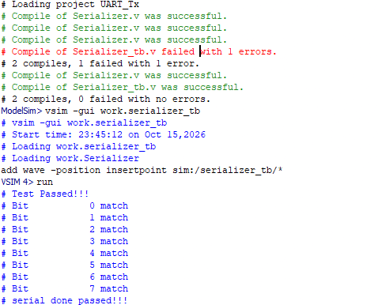
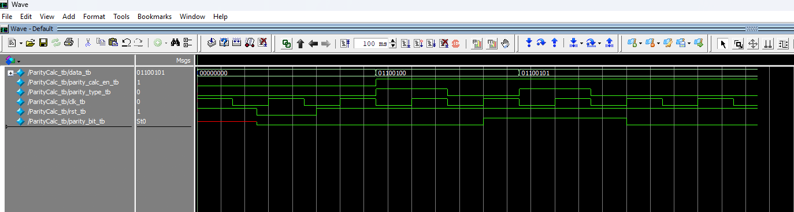
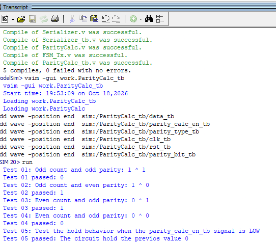
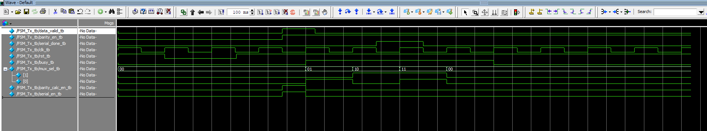
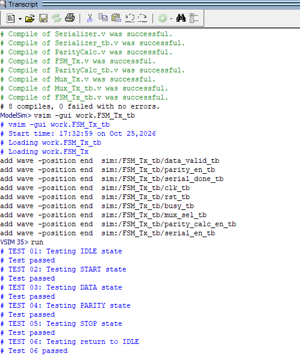
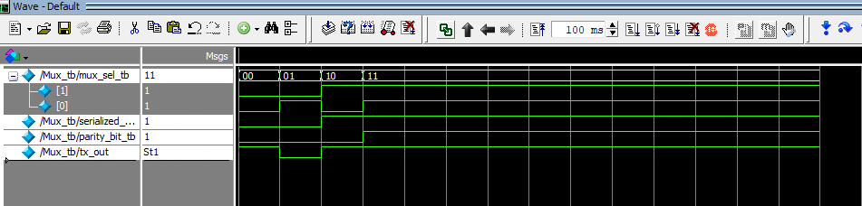
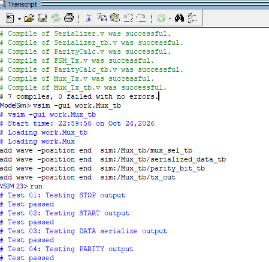

# UART (Work in Progress)

This project is being developed module by module. The serializer, parity calculator, transmit FSM, and output multiplexer implementations are complete; full transmitter integration and verification are still in progress.

## Current Progress

| Module | RTL design | Testbench and results |
| --- | --- | --- |
| [Serializer](#serializer) | Complete | Four frames checked; saved waveform and transcript included. |
| [Parity calculator](#parity-calculator) | Complete | Five checks pass; saved waveform and transcript included. |
| [Transmit FSM](#transmit-fsm) | Complete | Six checks pass for a parity-enabled frame; saved waveform and transcript included. |
| [Output multiplexer](#output-multiplexer) | Complete | Four checks pass; saved waveform and transcript included. |

## Serializer

### RTL Design

[Serializer.v](Tx/Serializer.v) captures an 8-bit input when `serial_en` is high and the serializer is inactive. After capture, it shifts the stored data right and outputs one bit per rising clock edge, least significant bit first, over eight clock cycles.

| Signal | Behavior |
| --- | --- |
| `data[7:0]` | Input byte captured when a serialization request is accepted. |
| `serial_en` | Enables input capture when the serializer is inactive. |
| `serial_data` | Registered serial output, starting with bit 0. |
| `serial_done` | Asserts with the eighth serialized bit and clears on the next clock edge. |
| `rst` | Asynchronous active-low reset that clears the outputs and internal state. |

### Testbench

[Serializer_tb.v](Tx/Serializer_tb.v) applies reset, pulses the enable, and checks input capture, each serialized bit, and completion for `8'd10`, `8'h7D`, `8'hFF`, and `8'hE2`. Each frame includes eight serialized-bit checks and a check that `serial_done` asserts with the final bit.

### Results

The serializer and its testbench compile successfully with ModelSim Intel FPGA Edition 2020.1 with zero errors and zero warnings. Functional simulation passes all four frames, including 32 serialized-bit checks and four completion checks.

#### Simulation Waveform

The saved waveform shows the serializer processing `8'b00001010` (decimal 10). After the enable pulse, `serial_data_tb` outputs the bits least significant bit first, and `serial_done_tb` asserts when the eighth bit is serialized.

#### Test Transcript

The saved transcript shows successful input capture, matching output for all eight bits (0 through 7), and a passing `serial_done` check for input value 10. The current testbench also includes the additional input values listed above.

## Parity Calculator

### RTL Design

[ParityCalc.v](Tx/ParityCalc.v) computes `parity_bit <= (^data) ^ parity_type` on the rising edge of `clk` when `parity_calc_en` is high.

| Input | Behavior |
| --- | --- |
| `data[7:0]` | Eight data bits used to calculate parity. |
| `parity_calc_en` | Enables an update on the rising clock edge; when low, the previous parity bit is retained. |
| `parity_type` | `0` selects even parity; `1` selects odd parity. |
| `rst` | Asynchronous active-low reset that clears `parity_bit` to `0`. |

For example, `8'h7D` contains six set bits, so its parity bit is `0` for even parity and `1` for odd parity. Reset clears the output regardless of the selected parity mode.

### Testbench

[ParityCalc_tb.v](Tx/ParityCalc_tb.v) checks all four combinations of even/odd set-bit counts and even/odd parity using `8'b01100100` (100) and `8'b01100101` (101). A fifth check changes the data to `8'b00000000` and selects odd parity while disabling calculation; the output must retain its previous value of `0`, although the new inputs would produce `1` if enabled.

The testbench applies reset during initialization. Dedicated assertions for reset behavior and retention of `1` remain to be added.

### Results

The parity calculator and its testbench compile successfully with ModelSim Intel FPGA Edition 2020.1 with zero errors and zero warnings. All five functional checks pass.

| Test | Data | Set-bit count | Parity mode | Expected parity bit | Result |
| --- | --- | --- | --- | --- | --- |
| 01 | `8'b01100100` (100) | 3 (odd) | Odd (`1`) | `0` | Passed |
| 02 | `8'b01100100` (100) | 3 (odd) | Even (`0`) | `1` | Passed |
| 03 | `8'b01100101` (101) | 4 (even) | Odd (`1`) | `1` | Passed |
| 04 | `8'b01100101` (101) | 4 (even) | Even (`0`) | `0` | Passed |
| 05 | `8'b00000000` (0) | 0 (even) | Odd (`1`), calculation disabled | `0` (retained) | Passed |

#### Simulation Waveform

The saved waveform shows the active-low reset clearing `parity_bit_tb`, followed by parity calculations for inputs 100 and 101. Each input is tested with odd parity and then even parity while `parity_calc_en_tb` is high. The final test checks output retention while calculation is disabled.

#### Test Transcript

The saved transcript shows all five checks passing: the four parity calculations produce `0`, `1`, `1`, and `0`, and Test 05 confirms that the output holds `0` when `parity_calc_en_tb` is low. The Test 04 description in the saved transcript says "odd parity"; its `parity_type_tb = 0` stimulus and expected output test even parity, as listed above.

## Transmit FSM

### RTL Design

The [FSM_Tx](Tx/FSM_Tx.v) implementation is complete. It sequences a frame through `IDLE -> START -> DATA -> PARITY -> STOP -> IDLE`, skipping `PARITY` when parity is disabled for the accepted frame.

While in `IDLE`, `rst` must be high and `data_valid` asserted to request transmission. The FSM asserts `serial_en` and `parity_calc_en` so both modules capture the frame data on the next rising clock edge. It also latches `parity_en` on that edge, keeping the parity decision fixed for the frame. The asynchronous active-low reset returns the state register to `IDLE`.

| State | `busy` | `mux_sel` | Behavior and next state |
| --- | --- | --- | --- |
| `IDLE` | `0` | `2'b00` | Waits for valid data; asserts both enables when a request is accepted, then enters `START`. |
| `START` | `1` | `2'b01` | Selects the start bit and advances to `DATA` on the next rising edge. |
| `DATA` | `1` | `2'b10` | Selects serialized data and waits for `serial_done`; then enters `PARITY` or `STOP` using the latched parity setting. |
| `PARITY` | `1` | `2'b11` | Selects the calculated parity bit and advances to `STOP` on the next rising edge. |
| `STOP` | `1` | `2'b00` | Selects the stop/idle level and returns to `IDLE` on the next rising edge. |

`serial_en` and `parity_calc_en` are low outside the accepted request in `IDLE`. The output multiplexer is implemented in `Mux_Tx.v`; connecting the transmitter modules and adding baud timing remain integration work.

### Testbench

[FSM_Tx_tb.v](Tx/FSM_Tx_tb.v) applies an active-low reset, pulses `data_valid` with parity enabled, and drives `serial_done` to exercise `IDLE -> START -> DATA -> PARITY -> STOP -> IDLE`. It uses a `1ns/1ps` timescale and a 5 ns clock period. The request enables are checked after a 0.1 ns combinational settling delay; state outputs are checked 1 ns after rising clock edges.

The six checks cover request enables in `IDLE`, busy and multiplexer selection in each active state, and the return to idle. Reset is applied but has no dedicated assertion. Parity-disabled frames, longer waits in `DATA`, changes to `parity_en` after acceptance, reset during transmission, and enable deassertion outside `IDLE` remain to be checked.

### Results

The saved ModelSim transcript reports eight successful module/testbench compiles with no errors and all six FSM checks passing. The testbench drives the completion input directly; full transmitter integration remains to be verified.

| Test | Checked behavior | Result |
| --- | --- | --- |
| 01: IDLE request | `busy = 0`, `serial_en = 1`, `parity_calc_en = 1` | Passed |
| 02: START | `busy = 1`, `mux_sel = 2'b01` | Passed |
| 03: DATA | `busy = 1`, `mux_sel = 2'b10` | Passed |
| 04: PARITY | `busy = 1`, `mux_sel = 2'b11` | Passed |
| 05: STOP | `busy = 1`, `mux_sel = 2'b00` | Passed |
| 06: Return to IDLE | `busy = 0`, `mux_sel = 2'b00` | Passed |

#### Simulation Waveform

The waveform shows reset, the request enable pulses, and `mux_sel` progressing through `00`, `01`, `10`, `11`, and `00`. The FSM asserts `busy` during the active frame states and clears it when it returns to `IDLE`.

#### Test Transcript

The saved transcript shows successful compilation and all six FSM checks passing.

## Output Multiplexer

### RTL Design

[Mux_Tx.v](Tx/Mux_Tx.v) defines the combinational module `Mux`. Its `mux_sel` encoding matches the values generated by `FSM_Tx`:

| `mux_sel` | `tx_out` | Frame portion |
| --- | --- | --- |
| `2'b00` | `1'b1` | Stop bit or idle line level. |
| `2'b01` | `1'b0` | Start bit. |
| `2'b10` | `serialized_data` | Current data bit from the serializer. |
| `2'b11` | `parity_bit` | Calculated parity bit. |

The output follows the selected input without a clock or reset. The `default` branch drives `tx_out` low if the selector contains an unknown or high-impedance bit. In the transmitter top level, connect the FSM's `mux_sel`, the serializer's `serial_data` to `serialized_data`, and the parity calculator's `parity_bit`; `tx_out` is the UART transmit output. The multiplexer selects the line value; the integrated transmitter must provide the required bit timing.

### Testbench

[Mux_Tx_tb.v](Tx/Mux_Tx_tb.v) checks the stop/idle level, start bit, serialized data selection, and parity selection. It uses a `1ns/1ps` timescale and checks each selection after a 1 ns settling delay.

These checks cover each selector value. Additional coverage for low data and parity inputs, changes to unselected inputs, and unknown or high-impedance selector values remains to be added.

### Results

The multiplexer and its testbench compile successfully with ModelSim Intel FPGA Edition 2020.1. The saved simulation transcript shows all four functional checks passing.

| Test | `mux_sel` | Selected value | Expected `tx_out` | Result |
| --- | --- | --- | --- | --- |
| 01: Stop/idle | `2'b00` | Constant high | `1` | Passed |
| 02: Start | `2'b01` | Constant low | `0` | Passed |
| 03: Data | `2'b10` | `serialized_data = 1` | `1` | Passed |
| 04: Parity | `2'b11` | `parity_bit = 1` | `1` | Passed |

#### Simulation Waveform

The waveform shows the selector advancing through `00`, `01`, `10`, and `11`, with `tx_out` following the stop, start, data, and parity values.

#### Test Transcript

The saved ModelSim transcript shows successful compilation and all four multiplexer checks passing.

## Remaining Work

- Complete the UART transmitter by adding baud timing and integrating the completed FSM, serializer, parity calculator, and output multiplexer.
- Expand FSM coverage for parity-disabled frames, data wait cycles, latched parity settings, reset behavior, and enable deassertion.
- Expand multiplexer coverage to include both data and parity levels, changes to unselected inputs, and unknown or high-impedance selector values.
- Verify complete UART frames after integration and expand the existing module testbenches.
