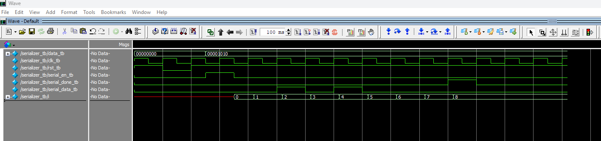

# UART (Work in Progress)

This project is being developed piece by piece. It is incomplete, and this snapshot is an early development checkpoint.

## Current Progress

- `Tx/Serializer.v`: captures an 8-bit input and serializes it least significant bit first over eight clock cycles.
- Provides a serialization enable input, a completion output, and an asynchronous active-low reset.
- [Serializer testbench](Tx/Serializer_tb.v): exercises reset, input capture, serialization of each bit, and the completion output using an input value of 10.

## Serializer Simulation Waveform

The waveform below shows the serializer processing `8'b00001010` (decimal 10). After the enable pulse, `serial_data_tb` outputs the bits least significant bit first, and `serial_done_tb` asserts when the eighth bit is serialized.

## Remaining Work

- Complete the UART transmitter, including baud timing and frame control.
- Add testbenches and verify the UART behavior as each component is completed.

The serializer alone is not a complete UART transmitter. The included testbench and waveform cover the serializer; verification of a complete UART transmitter remains future work.

Further components and verification results will be added as the project progresses.
