# UART (Work in Progress)

The serializer, parity calculator, transmit FSM, and output multiplexer are connected in the `TOP_Tx` transmitter top level. The integrated transmitter passes 36 checks covering three complete frames, both parity types, parity-disabled transmission, and idle behavior. Baud timing integration and additional corner-case coverage remain in progress. The receiver edge and bit counter and data sampler are implemented. The counter has 28 passing checks for edge counting and bit-period completion; the sampler has 177 passing checks across all supported prescales, asynchronous reset, and disabled output retention. Full receiver integration remains pending.

See the [UART_Tx README](Tx/README.md) for transmitter setup, interface, and verification commands, and the [receiver counter](#receiver-edge-and-bit-counter) and [data sampler](#receiver-data-sampler) sections for current receiver progress. Shared verification planning is available in [UART_Testbench_Corner_Cases.docx](UART_Testbench_Corner_Cases.docx).

## Current Progress

| Module | RTL design | Testbench and results |
| --- | --- | --- |
| [Serializer](#serializer) | Complete | Four frames, 40 checks pass; test summary and failure counting included; saved waveform and transcript included. |
| [Parity calculator](#parity-calculator) | Complete | Five checks pass; test summary and failure counting included; saved waveform and transcript included. |
| [Transmit FSM](#transmit-fsm) | Complete | Six checks pass for a parity-enabled frame; test summary and failure counting included; saved waveform and transcript included. |
| [Output multiplexer](#output-multiplexer) | Complete | Four checks pass; test summary and failure counting included; saved waveform and transcript included. |
| [Transmitter top level](#transmitter-top-level) | Integration complete | Three complete frames and one no-request idle test; all 36 checks pass with zero compile errors and warnings; saved waveform and two transcript images included. |
| [Receiver edge and bit counter](#receiver-edge-and-bit-counter) | Counter implemented; receiver integration pending | 28 checks pass for disabled counting and prescales 4 and 8; saved waveform and transcript included. |
| [Receiver data sampler](#receiver-data-sampler) | Implemented; receiver integration pending | 177 checks pass across prescales 4, 8, 16, and 32, reset, and disabled output retention; saved waveform and result images included. |

## Transmitter Top Level

### RTL Design

[TOP_UART_Tx.v](Tx/TOP_UART_Tx.v) defines the module `TOP_Tx` and connects the four transmitter blocks:

| Instance | Connection and role |
| --- | --- |
| `Serializer_inst` | Captures `INPUT_DATA` on `SERIAL_ENABLE`, supplies `SERIAL_DATA`, and signals completion with `SERIAL_DONE`. |
| `ParityCalc_inst` | Captures the parity calculation for `INPUT_DATA` using `PARITY_TYPE` when `PARITY_CALC_ENABLE` is asserted. |
| `FSM_Tx_inst` | Accepts `DATA_VALID`, latches the frame's `PARITY_ENABLE`, drives the capture enables and `MUX_SELECT`, and exposes `BUSY`. |
| `MUX_inst` | Selects idle/stop, start, serialized data, or parity to drive `TX_OUT`. |

### Interface

| Port | Direction | Behavior |
| --- | --- | --- |
| `INPUT_DATA[7:0]` | Input | Parallel data captured when a request is accepted in idle. |
| `DATA_VALID` | Input | Request transmission while `BUSY` is low; pulse for one clock cycle to request one frame. |
| `PARITY_ENABLE` | Input | `1` includes a parity bit; the FSM latches this setting when accepting the frame. |
| `PARITY_TYPE` | Input | `0` selects even parity; `1` selects odd parity. Sampled by the parity calculator at frame acceptance. |
| `CLK` | Input | Common clock for the serializer, parity calculator, and FSM. |
| `RST` | Input | Asynchronous active-low reset; returns the FSM to idle and clears serializer/parity state. |
| `BUSY` | Output | High during the start, data, optional parity, and stop states. |
| `TX_OUT` | Output | UART serial output: idle high, start low, eight data bits least significant bit first, optional parity, then stop high. |

Keep `INPUT_DATA`, `PARITY_ENABLE`, and `PARITY_TYPE` stable through the rising edge that accepts `DATA_VALID`. Requests during `BUSY` are not queued. Holding `DATA_VALID` high can request another frame when the FSM returns to idle.

The transmitter uses a fixed 8-bit data width. `TOP_Tx`, `Serializer`, and `ParityCalc` expose 8-bit data ports and have no data-width parameters. The serializer uses an eight-bit shift register and a three-bit counter to transmit exactly eight data bits.

There is no internal baud-rate generator or clock divider. The supplied `CLK` sets the bit timing: each start, data, parity, and stop bit occupies one clock period. Add baud timing before driving the transmitter from a faster system clock.

### Compilation and Verification Status

The following ModelSim Intel FPGA Edition 2020.1 commands compile the complete transmitter from the `UART/Tx` directory:

```text
vlib work
vlog -work work TOP_UART_Tx.v Serializer.v ParityCalc.v FSM_Tx.v Mux_Tx.v
```

On November 1, 2026, the fixed 8-bit top level, all four submodules, and the top-level testbench were compiled in ModelSim Intel FPGA Edition 2020.1 with zero errors and zero warnings. The top-level simulation completed at 236 ns with 36 checks passed and 0 failed. The saved top-level waveform and two transcript images below document the integrated simulation and its final check summary.

### Top-Level Testbench

[TOP_UART_Tx_tb.v](Tx/TOP_UART_Tx_tb.v) defines the simulation module `TOP_TX_TB`. It applies an active-low reset, uses a 5 ns clock period, and pulses `DATA_VALID` for one cycle for each requested frame. Output checks occur 1 ns after rising clock edges.

| Scenario | Data | Parity | Checks |
| --- | --- | --- | --- |
| Complete frame | `8'hC8` | Disabled | 11 |
| Complete frame | `8'h96` | Odd; expected parity bit `1` | 12 |
| Complete frame | `8'h82` | Even; expected parity bit `0` | 12 |
| No transmission request | `8'h8C`, `DATA_VALID = 0` | Disabled | 1 |

Each frame checks the low start bit, all eight data bits least significant bit first, the optional parity bit, the high stop bit, and the return to idle. `BUSY` must remain high during the frame and clear in idle. The no-request case checks `TX_OUT = 1` and `BUSY = 0`. Each check contributes once to the final summary.

The bench prints total/passed/failed counts, calls `$fatal(1, "TX_TOP TESTBENCH FAILED")` on failure, and prints `ALL TX_TOP TESTS PASSED` before `$finish` on success. Reset is applied during setup; reset during transmission and requests while busy remain untested.

### Running the Top-Level Testbench

From the `UART/Tx` directory:

```text
vlib work
vlog -work work TOP_UART_Tx.v Serializer.v ParityCalc.v FSM_Tx.v Mux_Tx.v TOP_UART_Tx_tb.v
vsim -c work.TOP_TX_TB -do "run -all; quit -f"
```

Create the `work` library only if it does not already exist. The expected final summary is:

```text
Total checks : 36
Passed       : 36
Failed       : 0
ALL TX_TOP TESTS PASSED
```

### Top-Level Simulation Results

#### Simulation Waveform

The waveform shows active-low reset, the one-cycle transmission requests, and the output for `8'hC8` without parity, `8'h96` with odd parity, and `8'h82` with even parity. `BUSY` is high during each frame and clears when the transmitter returns to idle. The final no-request case leaves `TX_OUT` high and `BUSY` low. The counters finish at 36 checks and 0 failures.

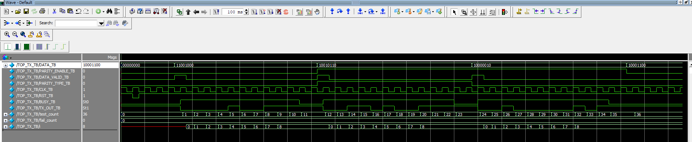

#### Test Transcript

The first transcript image shows ten successful RTL and testbench compilations with no errors, loading of the integrated transmitter, and passing start, data, stop, idle, and odd-parity checks.

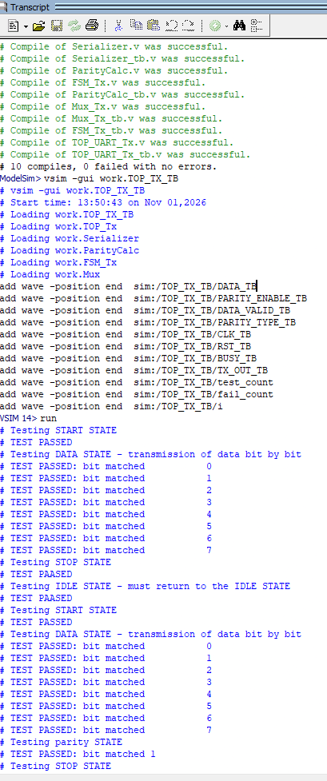

The second image continues the frame checks, including even parity and the no-request idle case. Its final summary reports 36 total checks, 36 passed, 0 failed, and `ALL TX_TOP TESTS PASSED`.

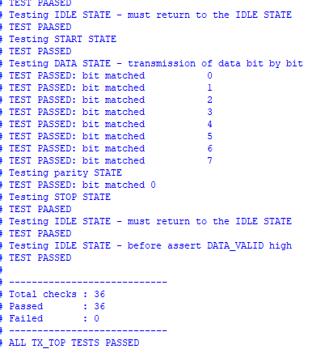

### Component Verification History

On October 28, 2026, the four component modules and their testbenches were recompiled with zero errors and zero warnings, and all 55 existing checks passed: 40 serializer checks, five parity checks, six FSM checks, and four multiplexer checks. The serializer total includes four input-capture checks. These results cover the component benches; the top-level results above cover complete transmitter frames.

### Running the Component Testbenches

From the `UART/Tx` directory, create the library if it does not already exist, compile the modules and benches, and run each bench separately:

```text
vlib work
vlog -work work Serializer.v Serializer_tb.v ParityCalc.v ParityCalc_tb.v FSM_Tx.v FSM_Tx_tb.v Mux_Tx.v Mux_Tx_tb.v
vsim -c work.serializer_tb -do "run -all; quit -f"
vsim -c work.ParityCalc_tb -do "run -all; quit -f"
vsim -c work.FSM_Tx_tb -do "run -all; quit -f"
vsim -c work.Mux_tb -do "run -all; quit -f"
```

Each bench counts checks and failures and prints a final total/passed/failed summary. A failed check causes `$fatal(1, ...)` at the end of the bench. A successful run prints a pass message and terminates with `$finish`. The saved transcript images predate the latest summary and termination updates.

## Serializer

### RTL Design

[Serializer.v](Tx/Serializer.v) uses a fixed 8-bit input port, shift register, and completion count. It captures an 8-bit input when `serial_en` is high and the serializer is inactive. After capture, it shifts the stored data right and outputs one bit per rising clock edge, least significant bit first, over eight clock cycles.

| Signal | Behavior |
| --- | --- |
| `data[7:0]` | 8-bit input captured when a serialization request is accepted. |
| `serial_en` | Enables input capture when the serializer is inactive. |
| `serial_data` | Registered serial output, starting with bit 0. |
| `serial_done` | Asserts with the eighth serialized bit and clears on the next clock edge. |
| `rst` | Asynchronous active-low reset that clears the outputs and internal state. |

### Testbench

[Serializer_tb.v](Tx/Serializer_tb.v) applies reset, pulses the enable, and checks input capture, each serialized bit, and completion for `8'd10`, `8'h7D`, `8'hFF`, and `8'hE2`. Each frame includes one input-capture check, eight serialized-bit checks, and a check that `serial_done` asserts with the final bit, giving 40 checks across all four frames. The testbench counts total checks and failures and prints a final total/passed/failed summary. Any failed check causes `$fatal(1, "SERIALIZER TESTBENCH FAILED")`; a successful run prints `ALL SERIALIZER TESTS PASSED` and terminates with `$finish`.

### Results

The serializer and its testbench compile successfully with ModelSim Intel FPGA Edition 2020.1 with zero errors and zero warnings. Functional simulation passes all four frames: four input-capture checks, 32 serialized-bit checks, and four completion checks. The updated testbench reports 40 total checks, 40 passed, and 0 failed.

#### Simulation Waveform

The saved waveform shows the serializer processing `8'b00001010` (decimal 10). After the enable pulse, `serial_data_tb` outputs the bits least significant bit first, and `serial_done_tb` asserts when the eighth bit is serialized.

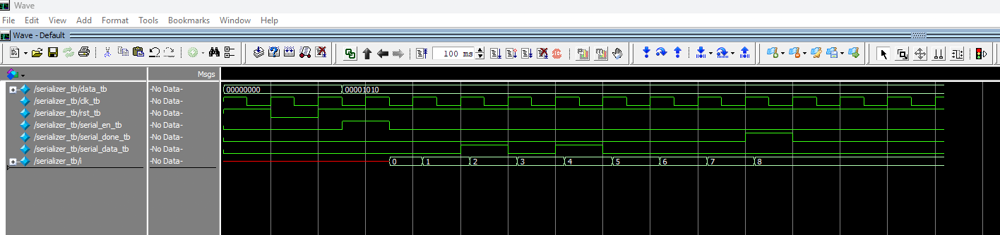

#### Test Transcript

The saved transcript shows successful input capture, matching output for all eight bits (0 through 7), and a passing `serial_done` check for input value 10. The current testbench also includes the additional input values listed above and the final check summary; the saved image predates that summary.

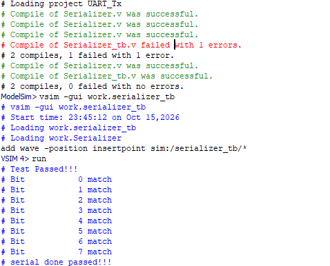

## Parity Calculator

### RTL Design

[ParityCalc.v](Tx/ParityCalc.v) computes `parity_bit <= (^data) ^ parity_type` on the rising edge of `clk` when `parity_calc_en` is high. Its input is fixed at eight bits; the reduction XOR includes all eight input bits.

| Input | Behavior |
| --- | --- |
| `data[7:0]` | Eight data bits used to calculate parity. |
| `parity_calc_en` | Enables an update on the rising clock edge; when low, the previous parity bit is retained. |
| `parity_type` | `0` selects even parity; `1` selects odd parity. |
| `rst` | Asynchronous active-low reset that clears `parity_bit` to `0`. |

For example, `8'h7D` contains six set bits, so its parity bit is `0` for even parity and `1` for odd parity. Reset clears the output regardless of the selected parity mode.

### Testbench

[ParityCalc_tb.v](Tx/ParityCalc_tb.v) checks all four combinations of even/odd set-bit counts and even/odd parity using `8'b01100100` (100) and `8'b01100101` (101). A fifth check changes the data to `8'b00000000` and selects odd parity while disabling calculation; the output must retain its previous value of `0`, although the new inputs would produce `1` if enabled.

The testbench uses a `1ns/1ps` timescale and applies reset during initialization. Dedicated assertions for reset behavior and retention of `1` remain to be added.

### Results

The parity calculator and its testbench compile successfully with ModelSim Intel FPGA Edition 2020.1 with zero errors and zero warnings. All five functional checks pass.

| Test | Data | Set-bit count | Parity mode | Expected parity bit | Result |
| --- | --- | --- | --- | --- | --- |
| 01 | `8'b01100100` (100) | 3 (odd) | Odd (`1`) | `0` | Passed |
| 02 | `8'b01100100` (100) | 3 (odd) | Even (`0`) | `1` | Passed |
| 03 | `8'b01100101` (101) | 4 (even) | Odd (`1`) | `1` | Passed |
| 04 | `8'b01100101` (101) | 4 (even) | Even (`0`) | `0` | Passed |
| 05 | `8'b00000000` (0) | 0 (even) | Odd (`1`), calculation disabled | `0` (retained) | Passed |

#### Simulation Waveform

The saved waveform shows the active-low reset clearing `parity_bit_tb`, followed by parity calculations for inputs 100 and 101. Each input is tested with odd parity and then even parity while `parity_calc_en_tb` is high. The final test checks output retention while calculation is disabled.

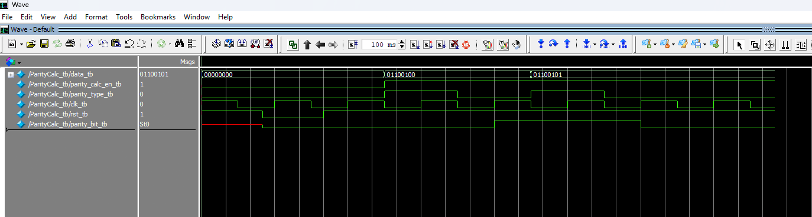

#### Test Transcript

The saved transcript shows all five checks passing: the four parity calculations produce `0`, `1`, `1`, and `0`, and Test 05 confirms that the output holds `0` when `parity_calc_en_tb` is low. The Test 04 description in the saved transcript says "odd parity"; its `parity_type_tb = 0` stimulus and expected output test even parity, as listed above. The current testbench corrects this label to "even parity".

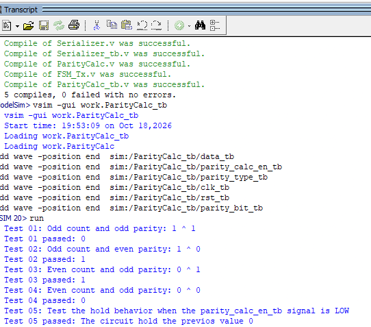

## Transmit FSM

### RTL Design

The [FSM_Tx](Tx/FSM_Tx.v) implementation is complete. It sequences a frame through `IDLE -> START -> DATA -> PARITY -> STOP -> IDLE`, skipping `PARITY` when parity is disabled for the accepted frame.

While in `IDLE`, `rst` must be high and `data_valid` asserted to request transmission. The FSM asserts `serial_en` and `parity_calc_en` so both modules capture the frame data on the next rising clock edge. It also latches `parity_en` on that edge, keeping the parity decision fixed for the frame. The asynchronous active-low reset returns the state register to `IDLE`.

| State | `busy` | `mux_sel` | Behavior and next state |
| --- | --- | --- | --- |
| `IDLE` | `0` | `2'b00` | Waits for valid data; asserts both enables when a request is accepted, then enters `START`. |
| `START` | `1` | `2'b01` | Selects the start bit and advances to `DATA` on the next rising edge. |
| `DATA` | `1` | `2'b10` | Selects serialized data and waits for `serial_done`; then enters `PARITY` or `STOP` using the latched parity setting. |
| `PARITY` | `1` | `2'b11` | Selects the calculated parity bit and advances to `STOP` on the next rising edge. |
| `STOP` | `1` | `2'b00` | Selects the stop/idle level and returns to `IDLE` on the next rising edge. |

`serial_en` and `parity_calc_en` are low outside the accepted request in `IDLE`. The output multiplexer is implemented in `Mux_Tx.v` and connected to the FSM in `TOP_Tx`. The top-level testbench covers complete frames with parity disabled and with both parity types; baud timing remains integration work.

### Testbench

[FSM_Tx_tb.v](Tx/FSM_Tx_tb.v) applies an active-low reset, pulses `data_valid` with parity enabled, and drives `serial_done` to exercise `IDLE -> START -> DATA -> PARITY -> STOP -> IDLE`. It uses a `1ns/1ps` timescale and a 5 ns clock period. The request enables are checked after a 0.1 ns combinational settling delay; state outputs are checked 1 ns after rising clock edges.

The six checks cover request enables in `IDLE`, busy and multiplexer selection in each active state, and the return to idle. Reset is applied but has no dedicated assertion. Parity-disabled frames, longer waits in `DATA`, changes to `parity_en` after acceptance, reset during transmission, and enable deassertion outside `IDLE` remain to be checked.

### Results

The saved ModelSim transcript reports eight successful module/testbench compiles with no errors and all six FSM checks passing. The component testbench drives the completion input directly; the top-level testbench separately checks complete frames through the integrated transmitter.

| Test | Checked behavior | Result |
| --- | --- | --- |
| 01: IDLE request | `busy = 0`, `serial_en = 1`, `parity_calc_en = 1` | Passed |
| 02: START | `busy = 1`, `mux_sel = 2'b01` | Passed |
| 03: DATA | `busy = 1`, `mux_sel = 2'b10` | Passed |
| 04: PARITY | `busy = 1`, `mux_sel = 2'b11` | Passed |
| 05: STOP | `busy = 1`, `mux_sel = 2'b00` | Passed |
| 06: Return to IDLE | `busy = 0`, `mux_sel = 2'b00` | Passed |

#### Simulation Waveform

The waveform shows reset, the request enable pulses, and `mux_sel` progressing through `00`, `01`, `10`, `11`, and `00`. The FSM asserts `busy` during the active frame states and clears it when it returns to `IDLE`.

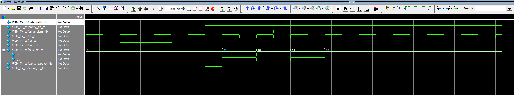

#### Test Transcript

The saved transcript shows successful compilation and all six FSM checks passing.

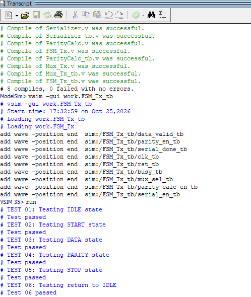

## Output Multiplexer

### RTL Design

[Mux_Tx.v](Tx/Mux_Tx.v) defines the combinational module `Mux`. Its `mux_sel` encoding matches the values generated by `FSM_Tx`:

| `mux_sel` | `tx_out` | Frame portion |
| --- | --- | --- |
| `2'b00` | `1'b1` | Stop bit or idle line level. |
| `2'b01` | `1'b0` | Start bit. |
| `2'b10` | `serialized_data` | Current data bit from the serializer. |
| `2'b11` | `parity_bit` | Calculated parity bit. |

The output follows the selected input without a clock or reset. The `default` branch drives `tx_out` low if the selector contains an unknown or high-impedance bit. In `TOP_Tx`, the FSM's `mux_sel`, the serializer's `serial_data`, and the parity calculator's `parity_bit` are connected through `MUX_SELECT`, `SERIAL_DATA`, and `PARITY_BIT`; the multiplexer output drives `TX_OUT`. The multiplexer selects the line value; the integrated transmitter must provide the required bit timing.

### Testbench

[Mux_Tx_tb.v](Tx/Mux_Tx_tb.v) checks the stop/idle level, start bit, serialized data selection, and parity selection. It uses a `1ns/1ps` timescale and checks each selection after a 1 ns settling delay.

These checks cover each selector value. Additional coverage for low data and parity inputs, changes to unselected inputs, and unknown or high-impedance selector values remains to be added.

### Results

The multiplexer and its testbench compile successfully with ModelSim Intel FPGA Edition 2020.1. The saved simulation transcript shows all four functional checks passing.

| Test | `mux_sel` | Selected value | Expected `tx_out` | Result |
| --- | --- | --- | --- | --- |
| 01: Stop/idle | `2'b00` | Constant high | `1` | Passed |
| 02: Start | `2'b01` | Constant low | `0` | Passed |
| 03: Data | `2'b10` | `serialized_data = 1` | `1` | Passed |
| 04: Parity | `2'b11` | `parity_bit = 1` | `1` | Passed |

#### Simulation Waveform

The waveform shows the selector advancing through `00`, `01`, `10`, and `11`, with `tx_out` following the stop, start, data, and parity values.

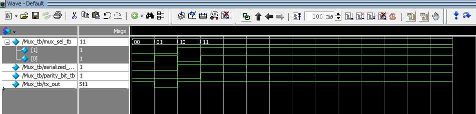

#### Test Transcript

The saved ModelSim transcript shows successful compilation and all four multiplexer checks passing.

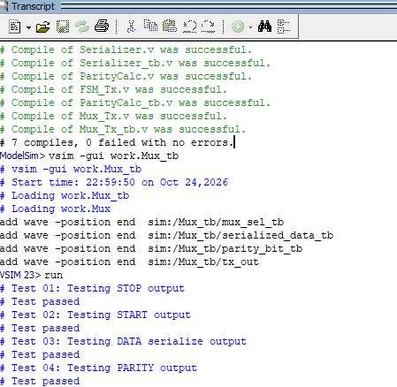

## Receiver Edge and Bit Counter

[Rx/Edge_Counter.v](Rx/Edge_Counter.v) defines `edge_bit_counter`, a timing block for the receiver under development. It accepts a receiver clock, asynchronous active-low `rst`, `enable`, `data_phase`, and a six-bit `Prescale` input. Supported prescales are 4, 8, 16, and 32.

| Output | Behavior |
| --- | --- |
| `edge_cnt[4:0]` | Counts receiver-clock positions from 0 through `Prescale - 1`, then wraps. |
| `bit_done` | Combinational indication that counting is enabled, the prescale is valid, and the current position is the last in the bit period. |
| `bit_cnt[2:0]` | Advances at bit completion only during `data_phase`; wraps after bit 7 and otherwise retains its value outside the data phase. |
| `last_data_bit` | Asserts with `bit_done` during the data phase when `bit_cnt = 7`. |

Reset clears both counters asynchronously. Disabling the block or selecting an unsupported prescale clears both counters on the next rising clock edge. The completion outputs are combinational and are not independently reset-gated.

### Testbench and Results

[Rx/Edge_Counter_tb.v](Rx/Edge_Counter_tb.v) checks `edge_cnt` and `bit_done` against expected values after each rising clock edge. Its 28 checks cover four disabled cycles, eight enabled cycles with prescale 4, and sixteen enabled cycles with prescale 8. All scenarios keep `data_phase = 0`.

On November 8, 2026, the receiver counter and testbench compiled with ModelSim Intel FPGA Edition 2020.1 with zero errors and zero warnings. Simulation finished at 156 ns with 28 checks and 0 failures. The five transmitter benches were also rerun, passing all 91 checks, for 119 passing checks across the UART project.

Prescales 16 and 32, enabled operation with invalid prescales, data-bit counting, `last_data_bit`, and reset during operation remain untested. This block has not yet been integrated into a complete receiver.

From `UART/Rx`, create the library if needed and run:

```text
vlib work
vlog -work work Edge_Counter.v Edge_Counter_tb.v
vsim -c work.edge_bit_counter_tb -do "run -all; quit -f"
```

Expected summary:

```text
Total Tests  : 28
Failed Tests : 0
```

### Saved Simulation Results

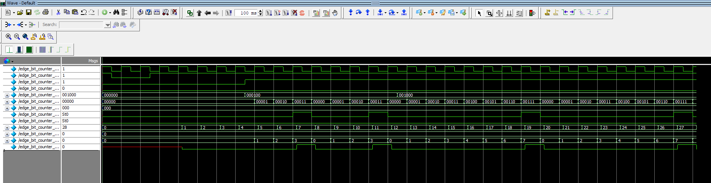

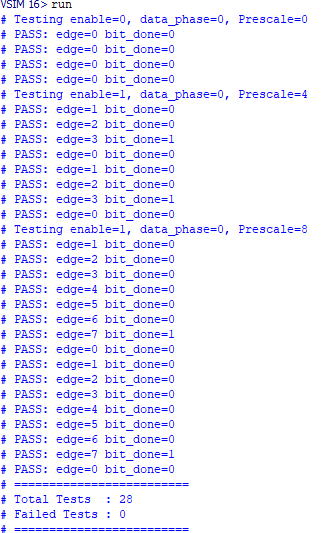

## Receiver Data Sampler

[Rx/Data_Sample.v](Rx/Data_Sample.v) defines `data_sample`, which samples the receiver input near the center of each bit period. It uses the receiver edge count and computes `mid_point = prescale >> 1`.

| Port | Direction | Behavior |
| --- | --- | --- |
| `rx_in` | Input | Serial receiver input to sample. |
| `prescale[5:0]` | Input | Receiver clocks per bit; use 4, 8, 16, or 32 to match the edge counter. |
| `edge_cnt[4:0]` | Input | Current receiver-clock position within the bit period. |
| `clk` | Input | Receiver sampling clock; state updates on rising edges. |
| `rst` | Input | Asynchronous active-low reset; clears the output and both stored samples. |
| `data_sample_en` | Input | Enables sampling; when low, clears the stored samples on the next rising edge and retains `sample_bit`. |
| `sample_bit` | Output | Registered sample result, retained until the next sampling decision or reset. |

With prescale 4, the block samples `rx_in` once at `edge_cnt = 2`. With prescales 8, 16, and 32, it captures three samples at `mid_point - 1`, `mid_point`, and `mid_point + 1`, then updates `sample_bit` with their majority value on the third sampling edge.

| Prescale | Sampling positions | Output update position |
| --- | --- | --- |
| 4 | 2 | 2 |
| 8 | 3, 4, 5 | 5 |
| 16 | 7, 8, 9 | 9 |
| 32 | 15, 16, 17 | 17 |

The majority decision is `(sample_one & sample_two) | (sample_one & rx_in) | (sample_two & rx_in)`. Keep the prescale stable throughout a bit period and enable sampling across the complete sampling window. The sampler does not reject unsupported prescales; its controller must supply a supported value. Receiver control and input synchronization remain integration work.

### Testbench and Results

[Rx/Data_Sample_tb.v](Rx/Data_Sample_tb.v) defines `data_sample_tb`, a self-checking bench with a 5 ns clock period. It drives inputs on falling edges, compares the output with a reference model 1 ns after rising edges, and independently checks the final decision for each complete bit period. Reset checks run 0.1 ns after reset assertion, before the next rising clock edge.

| Scenario | Stimulus and checks |
| --- | --- |
| Asynchronous reset | Clears the sampled output during initialization and after sampling a `1`; sampling resumes after reset. |
| Prescale 4 | Single midpoint sampling with patterns `010` and `000`. |
| Prescale 8 | Majority voting with patterns `101`, `010`, `111`, and `000`. |
| Prescale 16 | Majority voting with patterns `011` and `100`. |
| Prescale 32 | Majority voting with patterns `110` and `001`. |
| Sampling disabled | Holds a sampled `1` for two disabled cycles while `rx_in = 0`. |

For each three-bit pattern, the leftmost bit is the first sample, the middle bit is the midpoint sample, and the rightmost bit is the third sample. At prescale 4, only the middle bit determines the result.

On November 12, 2026, the sampler and its dedicated testbench compiled in ModelSim Intel FPGA Edition 2020.1 with zero errors and zero warnings. Simulation finished at 841 ns with 177 checks and 0 failures. The bench calls `$fatal(1, "Data sampling verification failed")` if any check fails and prints `ALL TESTS PASSED` before `$finish` on success.

From `UART/Rx`, create the `work` library if needed, then run:

```text
vlib work
vlog -work work Data_Sample.v Data_Sample_tb.v
vsim -c work.data_sample_tb -do "run -all; quit -f"
```

Expected final summary:

```text
DATA SAMPLE TEST RESULTS
Total checks : 177
Failed checks: 0
ALL TESTS PASSED
```

The sampler bench drives `edge_cnt` directly; it does not verify integration with the edge counter or a complete receiver. Coverage does not yet include every three-sample combination at every majority-voting prescale, disabling partway through a sampling window, or reset between individual samples.

### Saved Simulation Results

The waveform shows the supported prescales, sampled output, reset and enable behavior, and final counters of 177 checks and 0 failures.

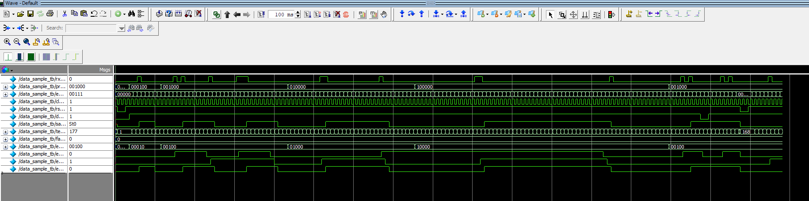

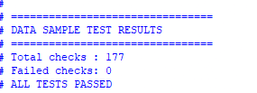

## Remaining Work

- Check that serializer completion stays low before the final bit and clears on the following clock edge; verify reset during serialization and input capture while the external data changes.
- Verify parity retention for both `0` and `1`, including multiple disabled clock cycles, and explicitly check asynchronous reset behavior.
- Add baud timing for operation from a faster system clock.
- Expand the top-level testbench with requests during busy, back-to-back requests, held-high `DATA_VALID`, input changes after acceptance, and reset during transmission.
- If configurable data widths are added later, update all data ports, serializer storage, completion counting, and tests together.
- Expand FSM coverage for parity-disabled frames, data wait cycles, latched parity settings, reset behavior, and enable deassertion.
- Expand multiplexer coverage to include both data and parity levels, changes to unselected inputs, and unknown or high-impedance selector values.
- Expand top-level frame data coverage and the existing module testbenches.
- Expand the receiver sampler testbench to cover every three-sample combination at each majority-voting prescale, disable/re-enable transitions within a sampling window, reset between samples, and retention of both output values while disabled.
- Integrate receiver control, input synchronization, the edge counter, and the data sampler into a complete receiver.
