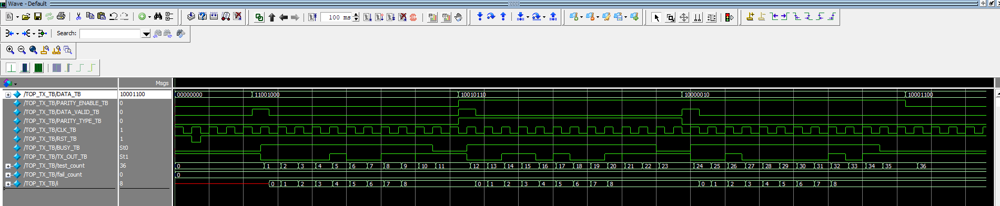

# UART Transmitter (UART_Tx)

Fixed 8-bit Verilog UART transmitter with optional even or odd parity. The top-level module is `TOP_Tx`, defined in [TOP_UART_Tx.v](TOP_UART_Tx.v).

A frame contains one low start bit, eight data bits sent least significant bit first, an optional parity bit, and one high stop bit. The output stays high while idle. Each bit lasts one `CLK` period; baud-rate generation is still to be added.

## Design Files

| RTL file | Module | Purpose |
| --- | --- | --- |
| [TOP_UART_Tx.v](TOP_UART_Tx.v) | `TOP_Tx` | Connects the four transmitter blocks. |
| [Serializer.v](Serializer.v) | `Serializer` | Captures the byte and shifts out eight data bits. |
| [ParityCalc.v](ParityCalc.v) | `ParityCalc` | Calculates and holds the frame's parity bit. |
| [FSM_Tx.v](FSM_Tx.v) | `FSM_Tx` | Sequences idle, start, data, optional parity, and stop. |
| [Mux_Tx.v](Mux_Tx.v) | `Mux` | Selects the serial output for each frame phase. |

## Top-Level Interface

| Port | Direction | Behavior |
| --- | --- | --- |
| `INPUT_DATA[7:0]` | Input | Byte captured when a request is accepted in idle. |
| `DATA_VALID` | Input | Pulse high for one clock while `BUSY = 0` to request a frame. |
| `PARITY_ENABLE` | Input | `1` includes parity; latched when the frame is accepted. |
| `PARITY_TYPE` | Input | `0` selects even parity; `1` selects odd parity. |
| `CLK` | Input | Bit-rate clock shared by the transmitter blocks. |
| `RST` | Input | Asynchronous active-low reset. |
| `BUSY` | Output | High throughout the start, data, parity, and stop phases. |
| `TX_OUT` | Output | Serial UART output; high in idle. |

Keep the byte and parity settings stable through the rising edge that accepts `DATA_VALID`. Requests asserted and removed while busy are not queued. Holding `DATA_VALID` high can request another frame once the FSM returns to idle. Parity is calculated as `(^INPUT_DATA) ^ PARITY_TYPE` at frame acceptance.

## Verification

All five transmitter testbenches were rerun on November 8, 2026 using ModelSim Intel FPGA Edition 2020.1. All 91 checks passed. Compilation completed with zero errors and zero warnings.

| Testbench file | Simulation module | Checks | Coverage |
| --- | --- | --- | --- |
| [TOP_UART_Tx_tb.v](TOP_UART_Tx_tb.v) | `TOP_TX_TB` | 36 | Three complete frames: `8'hC8` without parity, `8'h96` with odd parity, and `8'h82` with even parity; no-request idle behavior. |
| [Serializer_tb.v](Serializer_tb.v) | `serializer_tb` | 40 | Capture, eight output bits, and completion for four bytes. |
| [ParityCalc_tb.v](ParityCalc_tb.v) | `ParityCalc_tb` | 5 | Even/odd parity combinations and disabled output retention. |
| [FSM_Tx_tb.v](FSM_Tx_tb.v) | `FSM_Tx_tb` | 6 | Request enables and state outputs for a parity-enabled frame. |
| [Mux_Tx_tb.v](Mux_Tx_tb.v) | `Mux_tb` | 4 | Stop/idle, start, serialized data, and parity selections. |

Run these commands from `UART/Tx` in a ModelSim command shell. Create `work` only if it does not already exist.

```text
vlib work
vlog -work work TOP_UART_Tx.v Serializer.v ParityCalc.v FSM_Tx.v Mux_Tx.v TOP_UART_Tx_tb.v Serializer_tb.v ParityCalc_tb.v FSM_Tx_tb.v Mux_Tx_tb.v
vsim -c work.TOP_TX_TB -do "run -all; quit -f"
vsim -c work.serializer_tb -do "run -all; quit -f"
vsim -c work.ParityCalc_tb -do "run -all; quit -f"
vsim -c work.FSM_Tx_tb -do "run -all; quit -f"
vsim -c work.Mux_tb -do "run -all; quit -f"
```

Each bench prints total, passed, and failed counts and calls `$fatal` if a check fails. The top-level bench finishes at 236 ns with 36 checks passed and 0 failed.

## Saved Simulation Results

The saved images document earlier simulations; some component transcripts predate the current test summaries. See the [UART project README](../README.md) for detailed component results and all waveform and transcript images.



[Top-level transcript, part 1](tx_top_transcript-1.png) and [part 2, including the 36-check summary](tx_top_transcript-2.png).

## Remaining Work

- Integrate baud timing for use with a faster system clock.
- Test requests during busy, back-to-back requests, held-high `DATA_VALID`, input changes after acceptance, and reset during transmission.
- Extend component coverage for serializer completion timing, both retained parity values, FSM controls, and multiplexer input changes.

The [receiver](../README.md#receiver-edge-and-bit-counter) is under development. Shared verification planning is in [UART_Testbench_Corner_Cases.docx](../UART_Testbench_Corner_Cases.docx).
